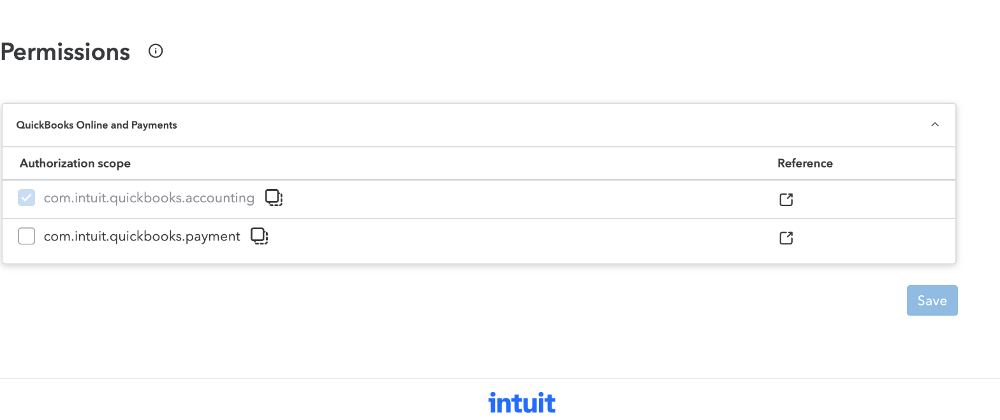
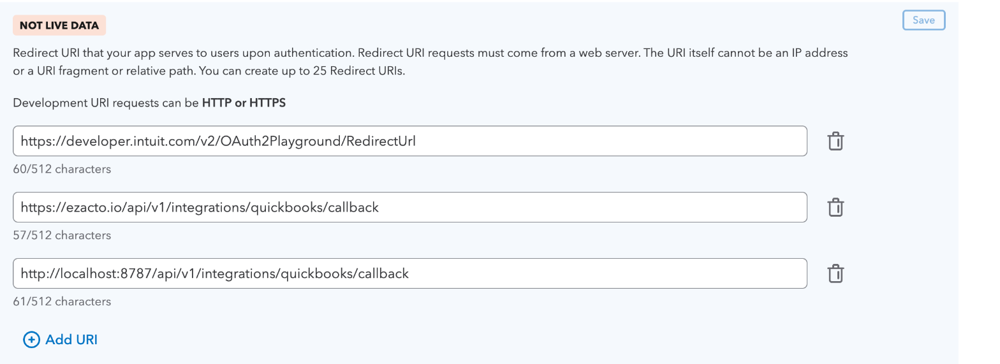
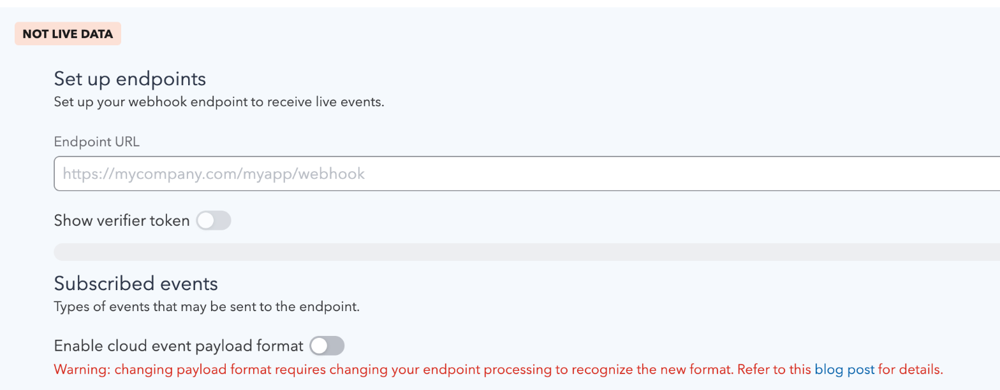

# Connecting ezacto to QuickBooks Online

What an operator has to do at Intuit before the **Connect to QuickBooks** button
can work, and why each step exists. Written from doing it, not from the API docs.

The short version: **the callback URL has to be registered at Intuit first.**
OAuth will not redirect anywhere it has not been told about in advance, so a
deployment whose callback is not on the list gets an Intuit error page instead of
a connected company, and nothing in ezacto's logs explains it.

Everything below is per *app*, and an app belongs to a workspace on
[developer.intuit.com](https://developer.intuit.com). You need two of them
eventually — one for development against a sandbox company, one for production —
because Intuit issues a separate pair of keys per environment and a sandbox key
cannot reach a real company's books.

---

## 1. Create the app

**My Hub → App dashboard → your workspace → Apps → +**, then give it a name.

The name is what an operator sees on Intuit's consent screen when they connect,
so it should be the product name rather than an internal one.

## 2. Ask for the accounting scope, and only that



`com.intuit.quickbooks.accounting` covers customers, invoices and the payments
recorded against them — both directions of the mirror.

**`com.intuit.quickbooks.payment` is not needed and should not be requested.**
It is the card-processing API: taking a payment ourselves, rather than reading
one QuickBooks already took. Asking for it "in case" means asking every operator
to grant card processing to an app that does not process cards, and Intuit shows
them exactly that on the consent screen.

Making a mirrored invoice *payable* does not need it either — that is
`AllowOnlineACHPayment` on the invoice, which rides on the accounting scope and
on the company's own QuickBooks Payments account.

> Intuit warns that permissions cannot be removed once added. They can be added
> later, so start narrow.

## 3. Register the callback URL

**Settings → Redirect URIs.** This is the step that is easy to miss and
impossible to work around.



Add one per deployment that will connect:

```
https://<your-host>/api/v1/integrations/quickbooks/callback
```

For local work, the development environment accepts plain HTTP, so
`http://localhost:8787/api/v1/integrations/quickbooks/callback` is valid. The
production environment does not — it must be HTTPS.

Intuit's own OAuth Playground URL is pre-filled and worth keeping: it is how you
test a token exchange without running ezacto at all.

### Two traps here, both of which cost me time

**The Save button is off-screen on a narrow window.** The panel's Save sits at
its top right, outside the viewport below roughly 1400px wide. Everything looks
editable, entries appear to take, and navigating away silently discards them —
there is no warning. If you do not see the toast reading *"Changes saved here and
in your settings"*, it did not save. Widen the window until Save is visible.

**Saving is per panel.** Each tab under Settings saves independently.

## 4. Webhooks, for payments coming back

**Webhooks → Development / Production.**



Three things matter:

| | |
| --- | --- |
| **Endpoint URL** | `https://<your-host>/webhooks/quickbooks` — on the site root, not under `/api/v1`, and not the OAuth callback. Must be publicly reachable HTTPS — Intuit will not deliver to localhost. For local work, use a tunnel. |
| **Verifier token** | Revealed by the toggle. Intuit signs every delivery with it (HMAC-SHA256, `intuit-signature` header), and the endpoint **must** verify that signature — the URL is public, and anything that reaches it is otherwise unauthenticated. |
| **Subscribed events** | Every entity is checked by default. Narrow it to **Invoice** and **Payment**; everything else is delivery volume for events that will be ignored. |

Leave *"Enable cloud event payload format"* off unless the endpoint has been
written for it — the warning on that toggle is accurate, and the two formats are
not interchangeable.

Configure the endpoint **after** it is deployed. Intuit begins delivering as soon
as it is saved, and deliveries to a URL that 404s are retried and then dropped.

### What a payment coming back does

A payment made in QuickBooks against a mirrored invoice is recorded on that
invoice. Two kinds are not:

- **One ezacto put there.** A payment recorded here — Mark paid, or another
  provider's — is copied into QuickBooks, and QuickBooks announces it like any
  other payment. It is recognised by the link the mirror saved, or by the
  `ez-<payment id>` reference stamped on it, and is not recorded a second time.
- **One larger than what the invoice still owes.** It is left unrecorded rather
  than overpaying the invoice; usually it is the same money already marked paid
  by hand. It is logged as `[payments] provider payment not recorded`, and the
  reason stays on the delivery in `quickbooks_webhook_deliveries.skipped_reason`
  for a person to settle.

## 5. Keys

**Keys and credentials**, per environment. The client ID and secret are revealed
by a toggle.

The secret is a credential: it belongs in the deployment's secret store, never in
the repository, never in a URL. ezacto sends it as HTTP Basic authorization on
the token exchange, which is where Intuit expects it.

Development keys reach sandbox companies only. Production keys require going
through Intuit's app assessment first, which is a separate process with its own
review — worth starting before you need it rather than on the day you do.

## 6. Production access

The **Production** tab of the app is locked behind Intuit's questionnaire. It
asks how the app handles OAuth and data; these are the answers that describe
ezacto, so they can be given without guessing:

| Intuit asks about | ezacto |
| --- | --- |
| The OAuth flow | Authorization code, browser-initiated by an administrator. No implicit flow, no client credentials. |
| Token refresh | Only when a call is about to be made and the stored access token is within two minutes of its expiry; never on a timer. The rotated refresh token is stored before the call goes out. |
| Endpoint discovery | Reads Intuit's OpenID discovery document rather than hardcoding endpoints. |
| Scopes | `com.intuit.quickbooks.accounting` only. No OpenID, no payments scope. |
| What is stored | The access and refresh tokens and the company (realm) id, in the deployment's database; refreshed tokens overwrite the old ones. Nothing from the books is copied except the ids of the invoices, customers and payments the mirror wrote or adopted. |
| Disconnect | Revokes the tokens at Intuit and forgets them. |
| Webhooks | Every delivery's HMAC signature is verified against the verifier token before it is read. |

Two things the production tab needs that the development tab did not: its own
**redirect URI** (the production host's `/api/v1/integrations/quickbooks/callback`,
HTTPS) and its own **webhook endpoint** with its own verifier token. The pairs
are per environment; a production key with the development callback registered
fails with *"The redirect_uri query parameter value is invalid"* at the consent
screen.

## 7. Where the keys go

Four values per deployment. The Worker reads them as secrets; the container
reads them from its environment.

| Name | Value |
| --- | --- |
| `QUICKBOOKS_CLIENT_ID` | the client ID of the environment's key pair |
| `QUICKBOOKS_CLIENT_SECRET` | its secret |
| `QUICKBOOKS_WEBHOOK_VERIFIER_TOKEN` | the verifier token of that environment's webhook |
| `QUICKBOOKS_ENVIRONMENT` | `sandbox` for a development key; anything else, including unset, is live books |

How they reach a deployment, and how to prove they did, is in
[Integrations: where the keys go](integrations.md). Once they are in place,
**Settings → Integrations** offers **Connect to QuickBooks** and, after the
consent screen, names the connected company.

---

## What ezacto does with all of this

1. An administrator opens **Settings → Integrations** and presses **Connect to
   QuickBooks**.
2. ezacto reads Intuit's OAuth discovery document (`/.well-known/openid_configuration`,
   or the sandbox one when `QUICKBOOKS_ENVIRONMENT=sandbox`) for the current
   authorization, token and revocation endpoints, caching it for an hour and
   falling back to the published endpoints if it cannot be read, then redirects
   to Intuit with the client ID, the accounting scope, the registered callback,
   and a single-use `state`.
3. The operator picks a company and approves.
4. Intuit redirects back to the callback with a code, the `realmId` of the
   company they chose, and the `state` — which is checked before anything else
   happens. A callback whose state does not match is refused: without that check,
   a third party can walk an administrator through connecting *their* QuickBooks
   company to your instance.
5. ezacto exchanges the code for tokens and stores them against that realm.

From then on invoices mirror out when they are sent, and payments travel both
ways: one recorded in QuickBooks comes back over the webhook, and one recorded
here (**Mark paid**, or **Record payment**) is filed against the mirrored
invoice in QuickBooks as a Payment. That payment carries the ezacto receipt id
as its reference number (`ez-<id>`), which is how a retry finds what an earlier
run made and how a bookkeeper tells the two systems' receipts apart. An invoice
that was never mirrored is mirrored first, then paid. A receipt that arrived
from QuickBooks is never sent back, and an edit or deletion of a payment here is
not copied out: the linked payment is the bookkeeper's pointer.

Books that already hold your invoices (from Harvest, or hand-entered) are the
common case on day one. An invoice QuickBooks already holds under the same
number is **adopted** when its total agrees to the cent, on every path: the
mirror that runs when an invoice is sent or a receipt is recorded here, the
**Sync to QuickBooks** button on the invoice page, and a payment made inside
QuickBooks that reaches the webhook. Nothing on the QuickBooks document
changes on adoption; only the invoice link is recorded, and payments go to the
customer the QuickBooks invoice is filed under. That customer is never changed
afterwards: Harvest filed one client under a sub-customer per project, and an
invoice stays where the books put it. The client's own customer link only
decides where invoices created here go. A number QuickBooks holds for a
different total is refused, and the invoice page says so.

Every mirror attempt leaves its result on the invoice, whether it created the
document, was refused (not connected when the invoice went out, a customer name
QuickBooks already holds under a different parent, an invoice number it holds
for somebody else), or failed outright (a lapsed token). The invoice page shows
that as a **QuickBooks** line under the facts -- *Not connected*, *Not synced:
reason*, or *Synced to QuickBooks invoice 147 on Sep 17 · 1 payment synced* --
and a **Sync to QuickBooks** button that mirrors the invoice and then every
payment on it not yet in QuickBooks. Pressing it twice creates nothing twice:
the links are what a second run finds. The button is for administrators and
accounting, and is not offered at all on a deployment without Intuit keys.
`GET /api/v1/invoices/:id/quickbooks` reports the same state and
`POST /api/v1/invoices/:id/quickbooks/sync` runs the same sync, answering 409
`quickbooks_refused` with the reason when the invoice mirror is refused.

## Sandbox companies

**My Hub → Sandboxes** gives you a QuickBooks company with fake data to connect
against. A development-key connection can only reach these, which is the safety
property that makes it reasonable to test the mirror at all: a bug writes an
invoice into a sandbox rather than into somebody's books.
